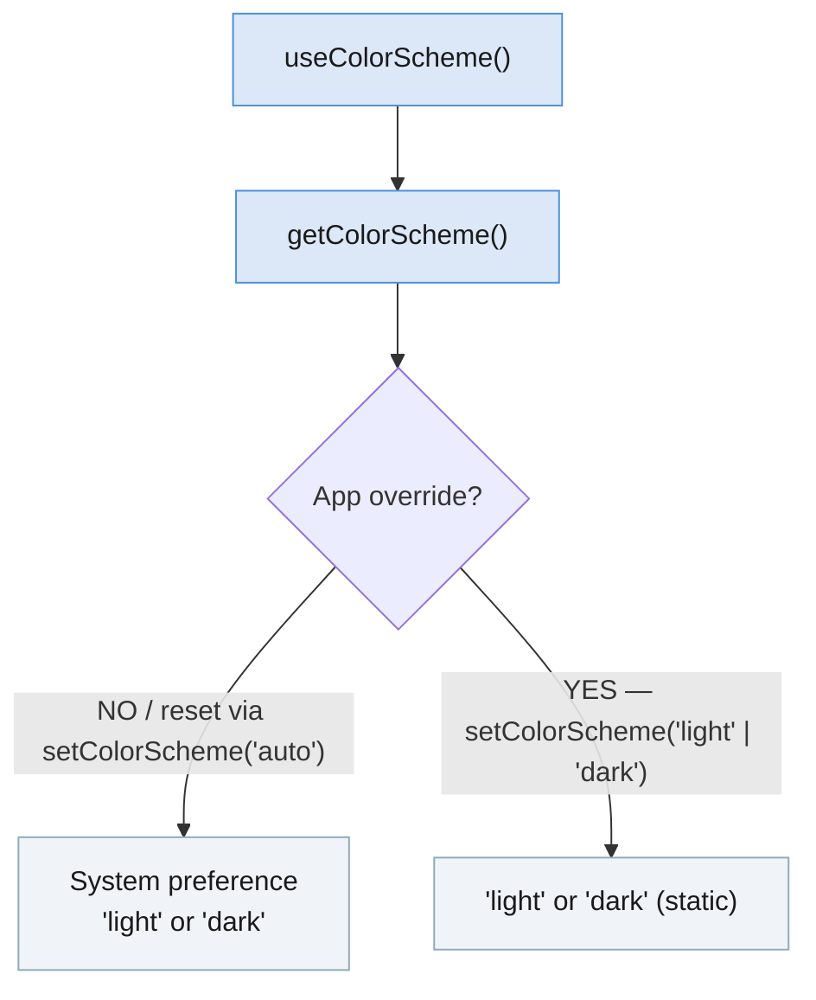

import Tabs from '@theme/Tabs'; import TabItem from '@theme/TabItem'; import constants from '@site/core/TabsConstants';

```tsx
import {Appearance} from 'react-native';
```

<<<<<<< pt
O módulo `Appearance` expõe informações sobre as preferências de aparência do usuário, como seu esquema de cores preferido (claro ou escuro).
||||||| base_en
The `Appearance` module exposes information about the user's appearance preferences, such as their preferred color scheme (light or dark).
=======
The `Appearance` module exposes information about the user's appearance preferences, such as their preferred system color scheme (light or dark).
>>>>>>> new_en

#### Notas do desenvolvedor

<Tabs groupId="guide" queryString defaultValue="web" values={constants.getDevNotesTabs(["android", "ios", "web"])}>

<TabItem value="web">

:::info
<<<<<<< pt
A API `Appearance` é inspirada no [rascunho de Media Queries](https://drafts.csswg.org/mediaqueries-5/) do W3C. A preferência de esquema de cores é modelada após a [feature CSS `prefers-color-scheme`](https://developer.mozilla.org/en-US/docs/Web/CSS/@media/prefers-color-scheme).
||||||| base_en
The `Appearance` API is inspired by the [Media Queries draft](https://drafts.csswg.org/mediaqueries-5/) from the W3C. The color scheme preference is modeled after the [`prefers-color-scheme` CSS media feature](https://developer.mozilla.org/en-US/docs/Web/CSS/@media/prefers-color-scheme).
=======
The `Appearance` API is inspired by the [Media Queries draft](https://drafts.csswg.org/mediaqueries-5/) from the W3C. The color scheme preference is modeled after the [`prefers-color-scheme` CSS media feature](https://developer.mozilla.org/en-US/docs/Web/CSS/Reference/At-rules/@media/prefers-color-scheme).
>>>>>>> new_en
:::

</TabItem>
<TabItem value="android">

:::info
<<<<<<< pt
A preferência de esquema de cores mapeará para a preferência de tema Claro ou [Escuro](https://developer.android.com/guide/topics/ui/look-and-feel/darktheme) do usuário em dispositivos Android 10 (API level 29) e superiores.
||||||| base_en
The color scheme preference will map to the user's Light or [Dark theme](https://developer.android.com/guide/topics/ui/look-and-feel/darktheme) preference on Android 10 (API level 29) devices and higher.
=======
The color scheme preference will map to the user's Light or [Dark theme](https://developer.android.com/develop/ui/views/theming/darktheme) preference on Android 10 (API level 29) devices and higher.
>>>>>>> new_en
:::

</TabItem>
<TabItem value="ios">

:::info
<<<<<<< pt
A preferência de esquema de cores mapeará para a preferência de modo Claro ou [Escuro](https://developer.apple.com/design/human-interface-guidelines/ios/visual-design/dark-mode/) do usuário em dispositivos iOS 13 e superiores.
||||||| base_en
The color scheme preference will map to the user's Light or [Dark Mode](https://developer.apple.com/design/human-interface-guidelines/ios/visual-design/dark-mode/) preference on iOS 13 devices and higher.
=======
The color scheme preference will map to the user's Light or [Dark Mode](https://developer.apple.com/design/human-interface-guidelines/dark-mode) preference on iOS 13 devices and higher.
>>>>>>> new_en
:::

:::note
Ao tirar uma captura de tela, por padrão, o esquema de cores pode piscar entre modo claro e escuro. Isso acontece porque o iOS tira capturas em ambos os esquemas de cores e a atualização da interface do usuário com o esquema de cores é assíncrona.
:::

</TabItem>
</Tabs>

## Exemplo

Você pode usar o módulo `Appearance` para determinar se o usuário prefere um esquema de cores escuro:

```tsx
const colorScheme = Appearance.getColorScheme();
if (colorScheme === 'dark') {
  // Use dark color scheme
}
```

<<<<<<< pt
Embora o esquema de cores esteja disponível imediatamente, isso pode mudar (por exemplo, mudança programada de esquema de cores ao nascer ou pôr do sol). Qualquer lógica de renderização ou estilos que dependam do esquema de cores preferido do usuário devem tentar chamar esta função em cada renderização, em vez de armazenar o valor em cache. Por exemplo, você pode usar o hook React [`useColorScheme`](usecolorscheme), pois ele fornece e assina atualizações de esquema de cores, ou você pode usar estilos inline em vez de definir um valor em um `StyleSheet`.
||||||| base_en
Although the color scheme is available immediately, this may change (e.g. scheduled color scheme change at sunrise or sunset). Any rendering logic or styles that depend on the user preferred color scheme should try to call this function on every render, rather than caching the value. For example, you may use the [`useColorScheme`](usecolorscheme) React hook as it provides and subscribes to color scheme updates, or you may use inline styles rather than setting a value in a `StyleSheet`.
=======
Although the color scheme is available immediately, this may change when not overridden via `setColorScheme()` (e.g. scheduled color scheme change at sunrise or sunset). Any rendering logic or styles that depend on the user preferred color scheme should try to call this function on every render, rather than caching the value.

**Recommended:** Use the [`useColorScheme`](usecolorscheme) hook.

### App-level overriding

`setColorScheme()` overrides the color scheme at the application level — it does not affect the system setting or other applications. Passing `'auto'` removes any override, restoring the system preference.


>>>>>>> new_en

---

# Referência

## Métodos

### `getColorScheme()`

```tsx
static getColorScheme(): 'light' | 'dark' | null;
```

<<<<<<< pt
Indica o esquema de cores preferido atual do usuário. O valor pode ser atualizado posteriormente, seja através de ação direta do usuário (por exemplo, seleção de tema nas configurações do dispositivo ou estilo de interface do usuário selecionado no nível do aplicativo via `setColorScheme`) ou de forma programada (por exemplo, temas claro e escuro que seguem o ciclo dia/noite).
||||||| base_en
Indicates the current user preferred color scheme. The value may be updated later, either through direct user action (e.g. theme selection in device settings or application-level selected user interface style via `setColorScheme`) or on a schedule (e.g. light and dark themes that follow the day/night cycle).
=======
Returns the active color scheme. This value may change at runtime, either at the system level (e.g. scheduled color scheme change at sunrise or sunset) or when overridden at the app level via `setColorScheme()`.
>>>>>>> new_en

<<<<<<< pt
Esquemas de cores suportados:
||||||| base_en
Supported color schemes:
=======
Return values:
>>>>>>> new_en

<<<<<<< pt
- `'light'`: O usuário prefere um tema de cores claro.
- `'dark'`: O usuário prefere um tema de cores escuro.
- `null`: O usuário não indicou um tema de cores preferido.
||||||| base_en
- `'light'`: The user prefers a light color theme.
- `'dark'`: The user prefers a dark color theme.
- `null`: The user has not indicated a preferred color theme.
=======
- `'light'`: The light color scheme is applied.
- `'dark'`: The dark color scheme is applied.
- `null`: May be returned if the native Appearance module is not available.
>>>>>>> new_en

<<<<<<< pt
Veja também: hook `useColorScheme`.

:::note
`getColorScheme()` sempre retornará `light` ao depurar com Chrome.
:::
||||||| base_en
See also: `useColorScheme` hook.

:::note
`getColorScheme()` will always return `light` when debugging with Chrome.
:::
=======
See also: [`useColorScheme`](usecolorscheme) (hook).
>>>>>>> new_en

---

### `setColorScheme()`

```tsx
static setColorScheme('light' | 'dark' | 'auto' | 'unspecified'): void;
```

<<<<<<< pt
Força o aplicativo a sempre adotar um estilo de interface claro ou escuro. O valor padrão é `null`, que faz com que o aplicativo herde o estilo de interface do sistema. Se você atribuir um valor diferente, o novo estilo se aplica ao aplicativo e a todos os elementos nativos dentro do aplicativo (Alerts, Pickers etc).
||||||| base_en
Force the application to always adopt a light or dark interface style. The default value is `null` which causes the application to inherit the system's interface style. If you assign a different value, the new style applies to the application and all native elements within the application (Alerts, Pickers etc).
=======
Forces the application to always adopt a light or dark interface style. The change applies to the application and all native elements within it (Alerts, Pickers, etc.).
>>>>>>> new_en

<<<<<<< pt
Esquemas de cores suportados:
||||||| base_en
Supported color schemes:
=======
This is an app-level override — it does not affect the system's selected interface style or any style set in other applications.
>>>>>>> new_en

<<<<<<< pt
- `light`: Aplicar estilo de interface do usuário claro.
- `dark`: Aplicar estilo de interface do usuário escuro.
- null: Seguir o estilo de interface do sistema.
||||||| base_en
- `light`: Apply light user interface style.
- `dark`: Apply dark user interface style.
- null: Follow the system's interface style.
=======
Supported values:
>>>>>>> new_en

<<<<<<< pt
:::note
A mudança não afetará o estilo de interface selecionado do sistema ou qualquer estilo definido em outros aplicativos.
:::
||||||| base_en
:::note
The change will not affect the system's selected interface style or any style set in other applications.
:::
=======
- `'light'`: Apply light color scheme.
- `'dark'`: Apply dark color scheme.
- `'auto'`: Follow the system color scheme (removes any override).
- `'unspecified'` (**deprecated**): Follow the system color scheme (removes any override).
>>>>>>> new_en

---

### `addChangeListener()`

```tsx
static addChangeListener(
  listener: (preferences: {colorScheme: 'light' | 'dark' | null}) => void,
): EventSubscription;
```

<<<<<<< pt
Adiciona um manipulador de evento que é disparado quando as preferências de aparência mudam.
||||||| base_en
Add an event handler that is fired when appearance preferences change.
=======
Add an event handler that is fired when appearance preferences change. On iOS and Android, the `colorScheme` value in the callback is always `'light'` or `'dark'`.
>>>>>>> new_en
