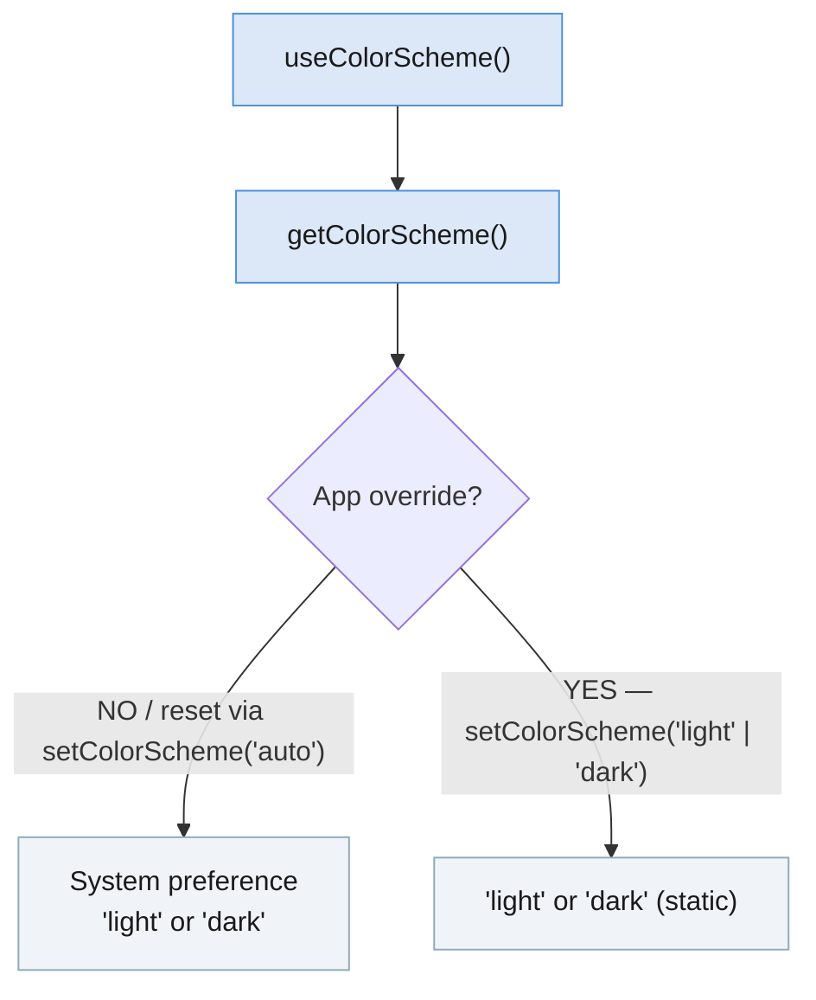

import Tabs from '@theme/Tabs'; import TabItem from '@theme/TabItem'; import constants from '@site/core/TabsConstants';

```tsx
import {Appearance} from 'react-native';
```

O módulo `Appearance` expõe informações sobre as preferências de aparência do usuário, como seu esquema de cores preferido do sistema (claro ou escuro).

#### Notas do desenvolvedor {#developer-notes}

<Tabs groupId="guide" queryString defaultValue="web" values={constants.getDevNotesTabs(["android", "ios", "web"])}>

<TabItem value="web">

:::info
A API `Appearance` é inspirada no [rascunho de Media Queries](https://drafts.csswg.org/mediaqueries-5/) do W3C. A preferência de esquema de cores é modelada após a [feature CSS `prefers-color-scheme`](https://developer.mozilla.org/en-US/docs/Web/CSS/Reference/At-rules/@media/prefers-color-scheme).
:::

</TabItem>
<TabItem value="android">

:::info
A preferência de esquema de cores mapeará para a preferência de tema Claro ou [Escuro](https://developer.android.com/develop/ui/views/theming/darktheme) do usuário em dispositivos Android 10 (API level 29) e superiores.
:::

</TabItem>
<TabItem value="ios">

:::info
A preferência de esquema de cores mapeará para a preferência de modo Claro ou [Escuro](https://developer.apple.com/design/human-interface-guidelines/dark-mode) do usuário em dispositivos iOS 13 e superiores.
:::

:::note
Ao tirar uma captura de tela, por padrão, o esquema de cores pode piscar entre modo claro e escuro. Isso acontece porque o iOS tira capturas em ambos os esquemas de cores e a atualização da interface do usuário com o esquema de cores é assíncrona.
:::

</TabItem>
</Tabs>

## Exemplo {#example}

Você pode usar o módulo `Appearance` para determinar se o usuário prefere um esquema de cores escuro:

```tsx
const colorScheme = Appearance.getColorScheme();
if (colorScheme === 'dark') {
  // Use dark color scheme
}
```

Embora o esquema de cores esteja disponível imediatamente, isso pode mudar quando não for substituído via `setColorScheme()` (por exemplo, mudança programada de esquema de cores ao nascer ou pôr do sol). Qualquer lógica de renderização ou estilos que dependam do esquema de cores preferido do usuário devem tentar chamar esta função em cada renderização, em vez de armazenar o valor em cache.

**Recomendado:** use o hook [`useColorScheme`](usecolorscheme).

### Substituição no nível do app {#app-level-overriding}

`setColorScheme()` substitui o esquema de cores no nível do aplicativo — ele não afeta a configuração do sistema nem outros aplicativos. Passar `'auto'` remove qualquer substituição, restaurando a preferência do sistema.



---

# Referência

## Métodos {#methods}

### `getColorScheme()`

```tsx
static getColorScheme(): 'light' | 'dark' | null;
```

Retorna o esquema de cores ativo. Este valor pode mudar em tempo de execução, seja no nível do sistema (por exemplo, mudança programada de esquema de cores ao nascer ou pôr do sol) seja quando substituído no nível do app via `setColorScheme()`.

Valores de retorno:

- `'light'`: O esquema de cores claro é aplicado.
- `'dark'`: O esquema de cores escuro é aplicado.
- `null`: Pode ser retornado se o módulo Appearance nativo não estiver disponível.

Veja também: hook [`useColorScheme`](usecolorscheme).

---

### `setColorScheme()`

```tsx
static setColorScheme('light' | 'dark' | 'auto' | 'unspecified'): void;
```

Força o aplicativo a sempre adotar um estilo de interface claro ou escuro. A mudança se aplica ao aplicativo e a todos os elementos nativos dentro dele (Alerts, Pickers etc.).

Esta é uma substituição no nível do app: não afeta o estilo de interface selecionado no sistema nem qualquer estilo definido em outros aplicativos.

Valores suportados:

- `'light'`: Aplica o esquema de cores claro.
- `'dark'`: Aplica o esquema de cores escuro.
- `'auto'`: Segue o esquema de cores do sistema (remove qualquer substituição).
- `'unspecified'` (**obsoleto**): Segue o esquema de cores do sistema (remove qualquer substituição).

---

### `addChangeListener()`

```tsx
static addChangeListener(
  listener: (preferences: {colorScheme: 'light' | 'dark' | null}) => void,
): EventSubscription;
```

Adiciona um manipulador de evento que é disparado quando as preferências de aparência mudam. No iOS e no Android, o valor `colorScheme` no callback é sempre `'light'` ou `'dark'`.
